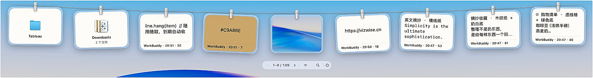
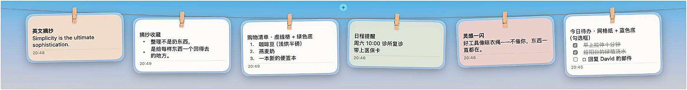
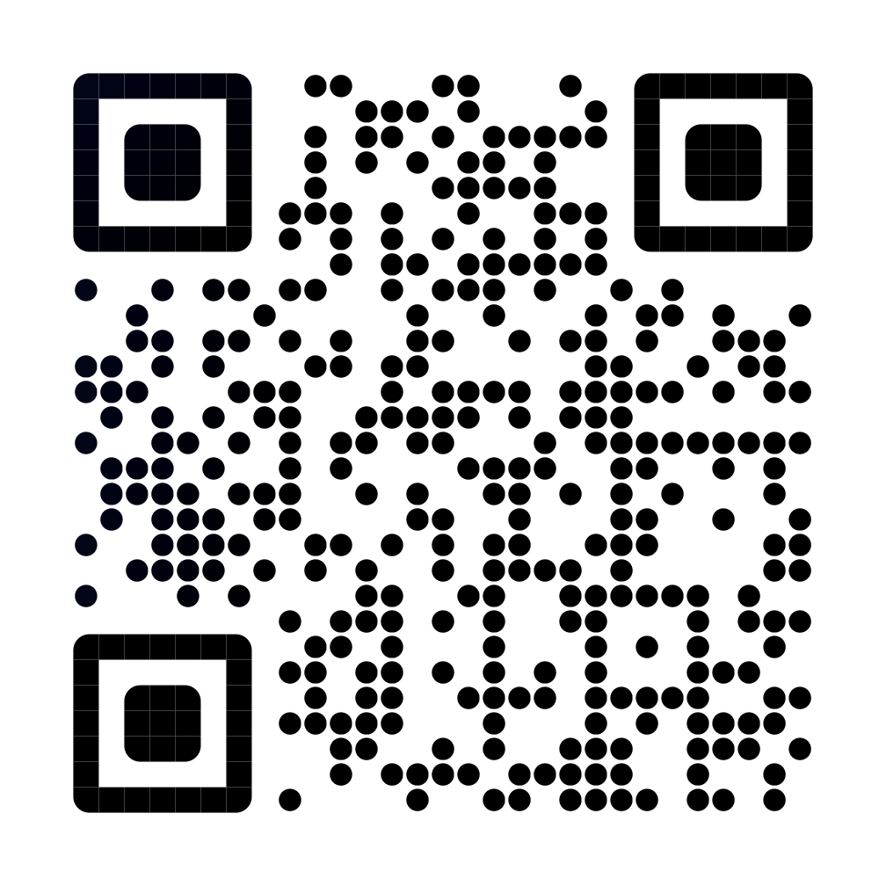

<p align="center">
  简体中文  ·  <a href="README.en.md">English</a>
</p>

<p align="center">
  <b>Clothespeg</b><br>
  一根晾衣绳，穿起剪贴板和便签簿。
</p>

<p align="center">
  免费开源 · macOS 14 及更高版本 · <a href="#致谢">基于 Tendedero</a>
</p>

Clothespeg 的灵感来自 Tendedero，西班牙语里的「晾衣绳」。一根晾衣绳穿起一个剪贴板、一个便签簿：复制过的截图、文字、文件夹都晾在上面，随用随取；便签也晾在绳上，写灵感、记待办，抬眼就在。刘海停一停，绳就放下来；移开，绳就收起，不打断手头的事。

## 剪贴板绳

复制的文字、代码、颜色、链接、图片、文件各自成卡：颜色卡背景随色值变化，图片显示缩略图。底部胶囊筛选栏，让筛选变得更轻松。卡片怎么点、怎么拖、怎么取下，可参考下面的[操作一览](#操作一览)。

<p align="center">
  
</p>

## 便签绳

点绳中间上方的 +，写一张便签。清单、待办、灵感都晾在另一条绳上，轻松呼出，随时查看。多种底色可选，分类查找更方便。

<p align="center">
  
</p>

## 便签提醒

便签也看时间。点便签页脚的铃铛，挑一个时间——15 分钟后、1 小时后，或者自己定——到点横幅弹出，卡片脚上写着「下次」和那一刻。每天、每周、每月可以选，循环下去。单次响过之后，脚上改写成「提醒已到」，点「知道了」把红点收走。写便签的当口就能设，不必先保存。

## 呼出方式

- **刘海停顿**：鼠标停在刘海左半区，剪贴板绳滑下来；停在右半区，出来的是便签绳。全屏应用上也能放。停顿时长三档可选：0.15 / 0.25 / 0.4 秒。
- **快捷键**：默认 ⌃⌥C 剪贴板、⌃⌥N 便签，可以录制成自己的，冲突即时提示。
- **修饰键翻转**：按住修饰键，左右两个区对调，一种手势管两条绳。

## 操作一览

绳子上的每张卡片都认得同一套手势，不必去设置里翻，这里一次列全。

### 卡片上的手势

| 手势       | 卡片会怎样                                                              |
| -------- | ------------------------------------------------------------------ |
| **悬停**   | 卡片微微浮起，淡入左上角的 ✕ 和右上角的按钮                                            |
| **单击**   | 复制到剪贴板，卡片下方闪一下「已复制」。便签例外：单击便签不复制，留给勾选框和滚动                          |
| **双击**   | 粘贴回上一个使用的 app——自动切回去、替你按下 ⌘V。未授权「辅助功能」时退化为仅复制，需要自己粘贴。便签双击是打开编辑     |
| **长按**   | 调系统「标注」编辑图片和 PDF，存盘后缩略图跟着更新。不能标注的卡片（文字、文件夹等）退化为复制                  |
| **按住拖动** | 拖进任何输入框、聊天窗口、邮件就是粘贴；拖进访达文件夹是真移动，原卡随之取下；拖到废纸篓上就是删除；拖去哪儿都没人接，卡片就飞回绳子 |
| **右键**   | 弹出菜单，见下文                                                           |

### 卡片角落的按钮

| 位置         | 按下会怎样                                                                      |
| ---------- | -------------------------------------------------------------------------- |
| 左上 **✕**   | 取下卡片：应用自己文件夹里的图片进废纸篓，外部文件只从绳上取下、原文件不动。**盯住的卡也认这个 ✕**，只是会先弹窗确认——删不删，再按一次才算数 |
| 右上 **放大镜** | 打开预览窗：图片直接看，文字可滚动、可选中，PDF 等文档走系统快速查看，一次复制多个文件时列出清单。链接卡这里直接开浏览器，文件夹卡开访达     |
| 笔记卡的**铅笔** | 打开笔记编辑窗                                                                    |
| 笔记页脚的**铃铛** | 打开提醒面板：定一个时间、要不要重复                                                        |
| 笔记的**勾选框** | 点一下划掉一行；全部勾完，整张便签变淡但不会消失                                                   |

### 右键菜单

随卡片类型增减，常用项都在：

- **复制**——文本卡在「复制纯文本」和「复制（带格式）」之间取反，跟设置里「复制时带上格式」开关正好互补：手势按开关来，右键永远备着另一副面孔。
- **盯住 / 取消盯住**——盯住的卡豁免自动清理、豁免清空；✕ 还在，只是删之前会先问一声。
- **打开 / 标注 / 在访达中显示**——标注只对图片和图片型 PDF 出现，走系统 Markup。
- **在浏览器中打开**——链接文本卡才有。
- **存储到桌面**——图片复制一份到桌面，文字存成 .txt。
- **丢弃 / 移到废纸篓**——应用文件夹内的图丢弃，外部文件移到废纸篓。盯住的卡不给这一项：取下它走 ✕，那里会先确认。

### 键盘

| 按键              | 行为                        |
| --------------- | ------------------------- |
| **⌃⌥C**         | 放下 / 收起剪贴板绳（可在设置里录制成别的）   |
| **⌃⌥N**         | 放下 / 收起便签绳（同上）            |
| **⌘↩**（指针悬在卡片上） | 打开这张卡的预览，再按一次关闭           |
| **Esc**         | 关预览、关搜索框；在笔记窗里按 Esc 保存并离开 |
| **⌘S**          | 保存笔记                      |

### 绳子本身

- **横向滚动 / 触控板横扫**翻页，胶囊两端的 ‹ › 逐屏翻，胶囊正中显示「当前 – 截止 / 总数」。
- **胶囊工具条**：按类型筛选（全部 / 文字 / 链接 / 颜色 / 图片 / 文件）、搜索、只看盯住的卡、按日期回看以前挂过的卡。
- **绳中间的 +**：新建便签。
- **收起绳子**：点绳子外面任意一处、再按一次快捷键，或指针离开片刻即收。
- **菜单栏图标**：实心 = 正在监控剪贴板，空心 = 已暂停。点图标弹菜单：呼出两条绳、新建便签、监控开关、系统截图自动上绳、设置、退出。

## 截图收件箱

想把系统截图存进剪贴板，macOS 的规矩是四个键一起按：⌃⌘⇧3 或 ⌃⌘⇧4。只按三个键呢？⌘⇧3 / ⌘⇧4 只把截图存到桌面，剪贴板什么也得不到。

Clothespeg 把第四个键省了。打开菜单里的「系统截图自动上绳」，之后照常按系统自带的 ⌘⇧3 或 ⌘⇧4 三键截屏，截图就直接进剪贴板、挂上绳子，截完随取随用。屏幕录制（⌘⇧5）也一样上绳——挂成文件卡，拖出去就是录屏本身。原来的保存位置先存起来，关闭开关或退出应用时自动恢复。整个过程不需要任何系统授权，因为被监视的文件夹就是应用自己的。默认关闭，不开就一切照旧。

## 暂存架

文件暂存架？复制就是。复制文件或文件夹，它就晾在绳上；要用了拖下来，丢进聊天窗口、邮件、终端都行。不用常驻一个侧边暂存架，绳子本身就是暂存架。一次复制多个也是一张卡，拖出来就复制。

## 更多细节

- **盯住**：右键选「盯住」，重要的卡不会被自动清理，也可以只看盯住的卡。
- **胶囊工具条**：按类型筛选（全部 / 文字 / 链接 / 颜色 / 图片 / 文件）、搜索、只看盯住的卡、按天翻看以前挂过的卡，都收在一个小胶囊里。
- **右键菜单**：打开；系统「标注」（图片和图片型 PDF 调系统 Markup，改完缩略图跟着更新）；在访达中显示；存储到桌面（文件复制一份，文字和链接存成 .txt）；链接在浏览器打开。删除只认卡片角上的 ×，删不删你自己定。
- **自动清理**：保留天数自选（7 / 14 / 30 / 90 天），盯住的卡不受影响。
- **隐私**：不联网，什么都不外发；密码管理器复制的内容永远不上绳，它们把自己标记为私密，Clothespeg 认这个标记。
- **中英双语**；菜单栏图标常驻，亮灭显示剪贴板监听状态。

## 安装

1. 从 [Releases](https://github.com/saodisir/Clothespeg/releases/latest) 下载 DMG，打开，把 Clothespeg 拖进「应用程序」。
2. 应用用 Developer ID 签名并经过苹果公证，直接打开即可。极少见的情况下仍被拦，去「系统设置 → 隐私与安全性」点「仍要打开」。

从 1.8.0 或更早版本升级：1.9.0 换了新的应用身份，设置和绳上的卡片都会自动搬过来，但「辅助功能」得重新授权一次（双击粘贴要用它）。旧的那份请先删掉，别在机器上留两个 Clothespeg。

## 从源码构建

```bash
git clone https://github.com/saodisir/Clothespeg.git
cd Clothespeg
scripts/build-app.sh debug    # 先在自己机器上试试，ad hoc 签名，不需要任何证书
scripts/build-app.sh          # release 产物，通用二进制（Apple silicon + Intel）
scripts/make-dmg.sh           # 打一个发布用的 DMG
```

需要 Xcode 自带的 Swift 工具链，除此之外没有任何依赖。

脚本做的事比一行 `swift build` 多：双架构 `lipo`、SDK 回退（Command Line Tools 的 macOS 27 SDK 缺
SwiftUI 宏插件）、图标生成、`Info.plist`（含 `LSUIElement` 所以不占 Dock）。所以脚本是这个项目
可构建的一部分，不是发布流程的一部分 —— **少了它，clone 下来只能拿到一个跑不起来的裸二进制。**

### 签名

脚本**签成这台机器上有的样子**，不写死任何公司名：

- 本机有 Developer ID → 用它，签完把证书名和 Team Identifier 打印出来
- 一个都没有 → ad hoc 签名，只在这台机器上能打开，并会明说这一点

要指定用哪张证书，发版时传进去：

```bash
SIGN_IDENTITY='Developer ID Application: Your Name (TEAMID)' \
RELEASE_TEAM=TEAMID \
scripts/build-app.sh release && scripts/make-dmg.sh
```

传了名字但钥匙串里没有 → **报错停下**，不会偷偷退而用另一张证书。
`make-dmg.sh` 要跟 `build-app.sh` 用同一张，否则镜像的签名跟镜像里的 app 对不上。

证书名不是密钥、也不需要藏：任何用 Developer ID 签名的 app 在 Gatekeeper 里都写着那个公司名，
`codesign -dv` 人人可读。**密钥才留在它所属的那台机器上，只有那台机器能签出东西。**

公证需要钥匙串里有 notary 凭证（`xcrun notarytool store-credentials clothespeg-notary ...`），
有的话脚本会自动提交并 staple；没有就只签名不公证。

## 给作者买杯咖啡

Clothespeg 免费开源，不放广告，也没有付费墙。如果它帮你省了时间，欢迎请作者喝杯咖啡。

<p align="center">
  <a href="https://cv4z8ffs.jsjform.com/p/j5Jhqc">
    
  </a>
</p>

<p align="center">
  扫码请喝，或 <a href="https://cv4z8ffs.jsjform.com/p/j5Jhqc">打开收款页面</a>
</p>

## 致谢

Clothespeg 由 [Alejandro Bujan](https://github.com/alejandrobujan) 的 **[Tendedero](https://github.com/alejandrobujan/tendedero)** fork 而来。绳、衣夹、毛玻璃，还有卡片落绳时的摆动，都是他的作品。

在这个基础上，Clothespeg 重写了数据模型（存内容而不是文件路径），默认挂文字和图片，新增了便签绳、盯住、胶囊工具条、截图收件箱开关和右键系统标注，呼出方式也可以自己调。

## 许可证

本项目涉及两份许可证，因为代码来自两个地方：

- **Tendedero（原项目）是 MIT** —— 绳、衣夹、毛玻璃、卡片落绳的摆动，出自
  Alejandro Buján之手，**始终是 MIT，未因本 fork 改变**。原文见 [LICENSE-MIT](LICENSE-MIT)。
- **本 fork 是 Apache License 2.0** —— 数据模型、便签绳、胶囊工具条、盯住隐藏、
  截图收件箱、翻页等新增部分。全文见 [LICENSE](LICENSE)，改动清单见 [NOTICE](NOTICE)。

MIT 允许其代码被重新授权进 Apache-2.0，所以两处并存是合法的。
**读到 Alejandro Buján 的部分适用 MIT，读到新增的部分适用 Apache-2.0。**

Apache-2.0 那半的**授权方是 VIZWISE (HONGKONG) LIMITED**，也是发布时签名所用的公司 ——
版权主体与签名主体是同一方，第 3 条的专利授权才立得住（专利授权只能由版权人给出）。

你可以自由地使用、修改、再分发，**包括闭源商用**。
Apache-2.0 另外给出一项**专利授权**（你不会因为用了这份代码而专利指控被反诉），
并要求**注明做了哪些改动**。

「Name and icon」的限制不在这份授权之内：Tendedero 与 Clothespeg 的名称与图标
都不在授权之列，再分发版本必须换名换图标，也不能暗示得到原作者背书。

